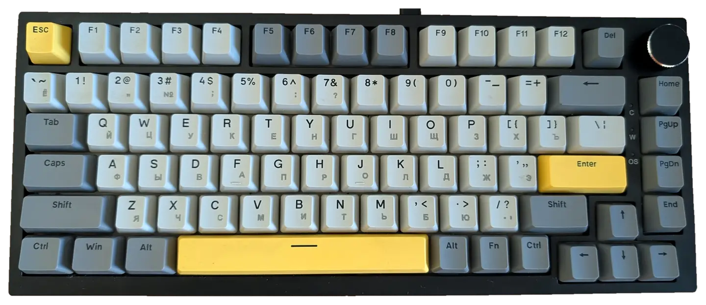
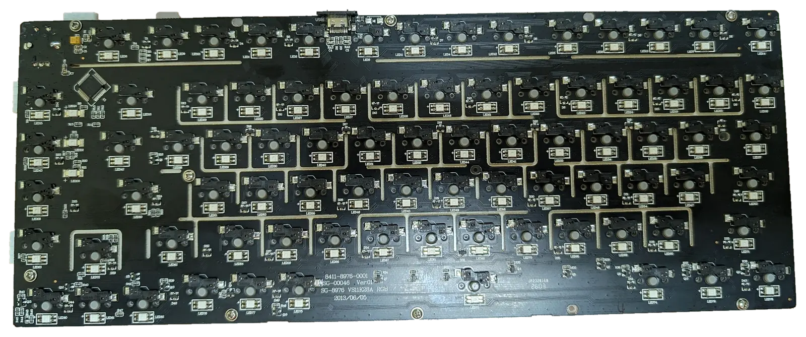
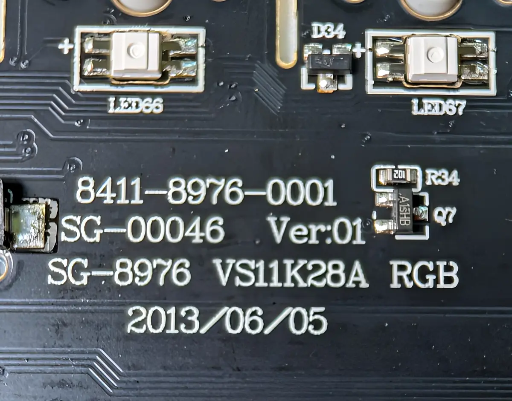
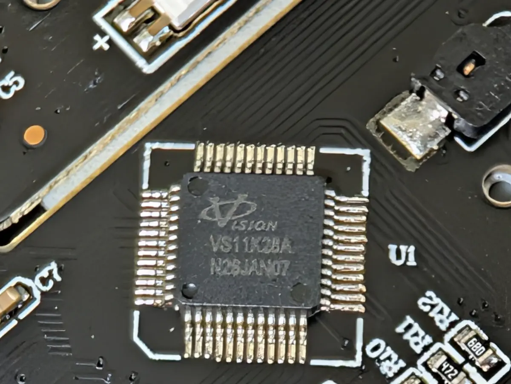

Русский перевод: [README на русском](docs/ru/README.md).

# QMK and Vial for AJAZZ AK820

This project brings QMK and Vial to the **wired AJAZZ AK820 with a VS11K28A / CH555-like 8051 controller**, USB `320F:505B`. AK820 V2, Pro and Max use different hardware and are not supported.

Set up keys, layers, the encoder and macros in Vial. After that, the keyboard works without a desktop app running in the background. The port keeps the keyboard's original loader and stores settings in the keyboard.

## Hardware Compatibility

| Model | Microcontroller | Support |
| --- | --- | --- |
| AJAZZ AK820 (wired) | VS11K28A | Supported |
| AJAZZ AK820 V2 | Different platform | No |
| AJAZZ AK820 Pro | Different platform | No |
| AJAZZ AK820 Max | Different platform | No |

USB VID:PID `320F:505B` is an additional identifying sign, not a compatibility guarantee. The AK820 name alone is not enough either. Check the controller and PCB revision against the photos below before installing firmware.

Keep the original recovery files and read [stock firmware recovery](docs/INSTALL.md#oem-recovery).



<a href="docs/images/pcb.webp"></a>
<a href="docs/images/pcb-markings.webp"></a>
<a href="docs/images/controller.webp"></a>

## Features

- Six layers, with separate clockwise and counterclockwise encoder actions on each layer.
- Standard keys, modifiers, media and system controls, plus NKRO (sending more than six keys at once).
- Sixteen macro slots with 8192 bytes of shared storage.
- Caps Word, Repeat, Alt Repeat, Grave Escape and Tri Layer.
- 82 RGB LEDs with solid color, breathing, color cycles, VialRGB Direct and a fade on the pressed key.
- Persistent keymaps, macros and global lighting; physical Vial unlock.
- The source installer can back up and restore supported settings locally and carry them through a supported firmware update. Tap-hold, One Shot, Mouse Keys, Tap Dance, Combos and Key Overrides are not supported by this profile.


## Get started

> Install only on the supported wired hardware revision. A mismatched image can leave the keyboard unusable; a matching USB ID does not make another revision safe.

Start with the [installation and recovery guide](docs/INSTALL.md) before using the installer.

Read [Settings backup](docs/SETTINGS-BACKUP.md) for the supported host-only
backup and restore commands. The feature supports the exact reviewed
SDCC 4.6 images listed there; the checked Windows binaries predate it.

For the source installer, Python 3.10+ is required. Verify the complete bundle offline:

```sh
# Linux
./AK820.sh verify
```

```powershell
# Windows
.\AK820.cmd verify
```

Use [Configuration](docs/CONFIGURATION.md) to remap keys, layers, macros and lighting in Vial. Firmware builds use Linux/WSL, Python 3.11+ and the pinned SDCC 4.6.0 toolchain.

Source builds produce a development candidate. The installer-verified release
image is a separate artifact. See [Build](docs/BUILD.md) and [Status](docs/STATUS.md)
for the current build and release state.

## Documentation and contributions

[Documentation](docs/INDEX.md) · [CI and releases](docs/CI.md) · [Build](docs/BUILD.md) · [Development](docs/DEVELOPMENT.md) · [Testing](docs/TESTING.md) · [Contributing](CONTRIBUTING.md)

English documentation is authoritative; Russian documents are translations. Preserve license notices when reusing the port. Original project code and contributions are GPL-3.0-only; third-party components retain their own licenses. See [licensing](docs/LICENSING.md) and the root [LICENSE](LICENSE).
