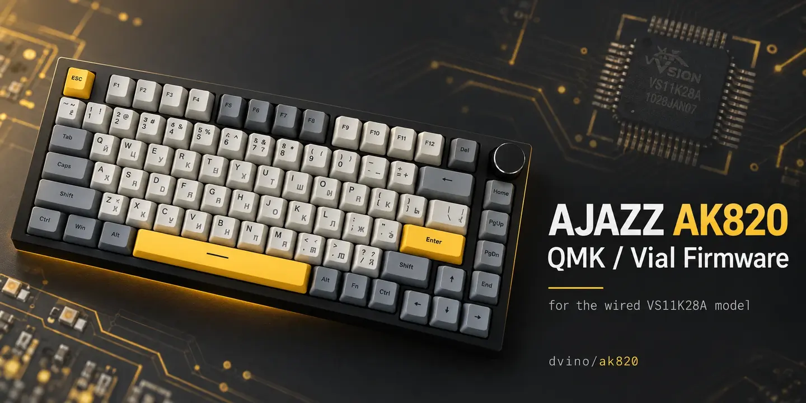

Русский перевод: [README на русском](docs/ru/README.md).

# QMK and Vial for AJAZZ AK820

This project brings QMK and Vial to the **wired AJAZZ AK820 with a VS11K28A / CH555-like 8051 controller**, USB `320F:505B`. AK820 V2, Pro and Max use different hardware and are not supported.

Set up keys, layers, the encoder and macros in Vial. After that, the keyboard works without a desktop app running in the background. The port keeps the keyboard's original loader and stores settings in the keyboard.

## Hardware Compatibility

| Model | Microcontroller | Support |
| --- | --- | --- |
| AJAZZ AK820 (wired) | VS11K28A | Supported |
| AJAZZ AK820 V2 | Different platform | No |
| AJAZZ AK820 Pro | Different platform | No |
| AJAZZ AK820 Max | Different platform | No |

USB VID:PID `320F:505B` is an additional identifying sign, not a compatibility guarantee. The AK820 name alone is not enough either. Check the controller and PCB revision against the photos below before installing firmware.

Keep the original recovery files and read [stock firmware recovery](docs/INSTALL.md#oem-recovery).

PCB and controller photos

## Features

The supported firmware provides six editable layers, per-layer encoder actions,
16 Vial macros, two-key Combos, media and system keys, NKRO reports, Caps Word,
Repeat and Alt Repeat, Grave Escape, Tri Layer, Mod-Tap and Layer-Tap, and RGB
lighting with VialRGB Direct. The **C** indicator follows Caps Lock; **W** shows
an active layer above layer 0. The [feature catalog](docs/FEATURES.md) describes
each function and its limits.

Optional modules extend that base in nine named source profiles. The default
`work` profile adds Leader, Dynamic Macros and OS indicator control. It excludes
Mouse Keys and Mac/PC mapping. Other packages cover typing, mouse controls,
system modifier mappings, Tap Dance, Key Overrides or QMK Settings; the
[profile guide](docs/BUILD-PROFILES.md) explains each package and the
[compatibility and size matrix](docs/MODULE-MATRIX.md) compares their features
and resource use.

The first [firmware beta](https://github.com/dvino/ak820/releases/tag/v0.6.0-beta.1) provides nine fixed profiles and capability data for the [AK Configurator](https://github.com/dvino/ak-configurator) companion application. Use the [module matrix](docs/MODULE-MATRIX.md) to compare them. The beta release includes standalone Windows and Linux x86_64 installers for the exact `work` image; the other eight profiles remain catalog candidates. See [Status](docs/STATUS.md) for verification and hardware limits.

## Disclaimer

The source code, firmware and tools are provided **“as is”, without warranties**
of any kind. Use, modification, flashing and recovery are performed at the
user's own risk. The user is responsible for checking hardware compatibility,
keeping backups and any resulting damage, an unusable device or loss of data.

To the extent permitted by applicable law, the authors and contributors are
not liable for damage or losses caused by using or being unable to use this
project. See sections 15–17 of the [LICENSE](LICENSE).

## Get started

> Install only on the supported wired hardware revision. A mismatched image can leave the keyboard unusable; a matching USB ID does not make another revision safe.

Download the Windows or Linux package from [Releases](https://github.com/dvino/ak820/releases), then follow the [installation and recovery guide](docs/INSTALL.md).

Read [Settings backup](docs/SETTINGS-BACKUP.md) for backup, restore and update
instructions.

Use [Configuration](docs/CONFIGURATION.md) to remap keys, layers, macros and lighting in Vial. To build from source, see [Build](docs/BUILD.md); firmware builds use Linux/WSL, Python 3.11+ and the pinned SDCC 4.6.0 toolchain. Every development profile build requires the [stack and interrupt check](docs/RUNTIME-STACK.md) before its other regression checks.

## Documentation and contributions

The whole-program development target is described in the [compression plan](docs/MAXIMUM-FUNCTIONALITY-PLAN.md).

[Documentation](docs/INDEX.md) · [AK Configurator](https://github.com/dvino/ak-configurator) · [CI and releases](docs/CI.md) · [Build](docs/BUILD.md) · [Development](docs/DEVELOPMENT.md) · [Testing](docs/TESTING.md) · [Contributing](CONTRIBUTING.md)

The companion application is maintained in [AK Configurator](https://github.com/dvino/ak-configurator). The [firmware handoff](web/docs/FIRMWARE-HANDOFF.md) describes its firmware contracts.

English documentation is authoritative; Russian documents are translations. Preserve license notices when reusing the port. Original project code and contributions are GPL-3.0-only; third-party components retain their own licenses. See [licensing](docs/LICENSING.md) and the root [LICENSE](LICENSE).
